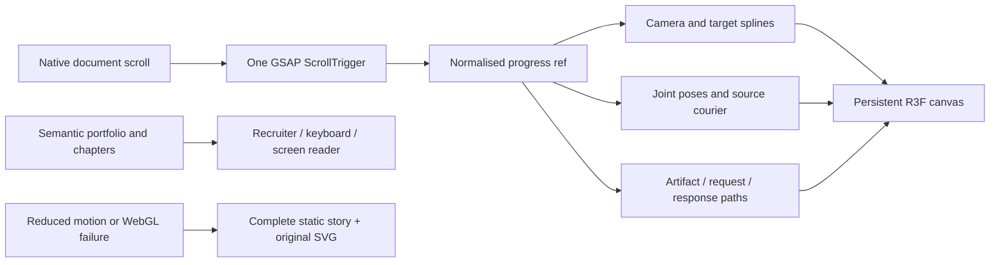

# Engineering Observatory V2 — implementation record

Date: 17 November 2026. Local release candidate; no commit, push, merge or deployment authorised by this task.

## Audit and preservation

Started on `feature/scroll-code-cinema`. Existing modified files were `package.json`, `package-lock.json`, and `src/app/page.jsx`. Existing untracked work comprised `public/illustrations`, CodeCinema/CodeJourney components and styles, `/engineering-world`, `/illustration`, and their four browser test files. A pre-edit copy plus Git diff/status is in ignored `artifacts/observatory-v2-before/`. None of those prototypes was deleted. No Git history operations were performed.

The existing homepage mounted the legacy hero and CodeCinema. CodeJourney's tests still targeted the homepage although that component was not mounted there. The separate 3D prototype had connected locations, reusable modelling concepts and readable fallback content, but a separate motion preference/controller, per-frame vector allocation and no homepage integration. Its scene text incorrectly associated Folio with React and used a POST health example. V2 uses independent modules and corrects those concepts without overwriting the prototype.

CV preserved exactly: `public/Prathmesh_Pawar_CV.pdf`, SHA-256 `B0278FE8521F99C92E2D2FF076E80D03411CB4EE708D656DEED66A073955B81F`. The reference illustration under `public/illustrations` was inspected for composition and atmosphere. It is not used as the V2 background. Existing academic status, employment details, contact links and project evidence boundaries remain intact.

## Reference findings

Source inspected at [Saurabh reference commit 0232c334](https://github.com/Saurabhsawant77/saurabh-portfolio/tree/0232c334b333c1e514f5fed41fad22bfca8fb804). Public HTML, four requested scripts and two stylesheets matched the repository blob hashes in the reference audit. Reference visual runtime inspection was unavailable; no visual performance comparison is claimed.

- `index.html` and `css/styles.css`: one fixed decorative rendering stage behind HTML, containing WebGL, labels and fallback layers.
- `js/scroll-controller.js`: section-derived camera states, damped scroll and interpolation; reverse scroll traverses the same camera states. Ambient motion remains time-based.
- `js/space-scene.js`: camera focus, distance and composition change continuously.
- `js/main.js`: hidden-page RAF cancellation, resize/font measurements, context-loss handling and DPR adaptation.
- `js/fallback-scene.js`: simplified CSS/2D fallback, not full visual parity.

Adapted the persistent-stage principle. No source, planetary models, imagery, layout or branding copied. V2 uses a new software-delivery storyline and original procedural assets. The specific nine-chapter portfolio brief takes precedence over generic placeholder identity/UX-designer positioning and the contradictory eight-stage example.

## Architecture

The canvas is fixed behind the main document, not remounted between chapters. Nine naturally scrolling HTML sections provide approximately nine viewport lengths of travel. There is no scroll hijacking or extra pinned DOM spacer. One ScrollTrigger maps actual scroll to a ref; React state changes only at chapter boundaries or mode changes. Camera and look-at targets use Catmull–Rom paths and interpolate field of view. Position is an exact function of scroll with no time-based camera lag. Reversal follows the same function.

The original Native Web Animations section reveals remain for the portfolio; they do not control scrolling or the camera. Lenis, old GSAP utilities and the old prototypes are not mounted on the homepage.

## Story and technical boundaries

1. **Idea:** development workstation, seated articulated engineer, plausible C# screen.
2. **Code:** camera push-in, typing poses, stand and source-artifact pickup.
3. **Git:** courier walks along the connected path; branch/review/merge metaphor.
4. **Build:** checkout → restore → build → tests → publish. Indicator lights are illustrative, never live CI status.
5. **Deploy:** published output reaches a host; wide connected-world reveal.
6. **Request:** Folio browser search begins a separate cyan HTTP packet.
7. **Backend:** routing, controller, application logic, EF Core boundaries.
8. **Data/response:** database query and amber return path through application layers.
9. **Experience:** interface modules assemble and synthetic book cards populate; real read-only Folio link.

Folio's actual frontend is Razor and JavaScript. The portfolio itself uses React. The diagram is a simplified architectural explanation, not a claim that Folio has a particular additional repository abstraction or that a recorded production request traversed these objects. The visible SQL/C# are representative excerpts, not imported proprietary source. Source code does not travel with HTTP responses. Synthetic screen titles are illustration content, not claims about the live catalogue's records.

## Module map / editing

| File under `src/app/components/world/` | Responsibility |
|---|---|
| `story.js` | Chapter copy, location coordinates, camera knots and timing helpers |
| `EngineeringWorld.jsx` | Semantic sections, chapter navigation, skip and quality controls, graphics boundary |
| `useScrollDirector.js` | Single authoritative progress and lifecycle cleanup |
| `WorldCanvas.jsx` | Canvas, capability check, connected routes, packets, clouds, frame scheduling |
| `WorldCamera.jsx` | Desktop/portrait camera interpolation and rendered-state diagnostics |
| `WorldPrimitives.jsx` | Original materials, platforms, tubes, screen textures and labels |
| `Environments.jsx` | Workstation, Git, forge, gateway, backend, database, Folio browser |
| `DeveloperCharacter.jsx` | Original articulated geometry and scroll-controlled joint poses |
| `WorldFinish.jsx` | Authored reflection map, restrained bloom, render-pass lifecycle |
| `WorldFallback.jsx` | Original static vector network; no required information in canvas |
| `world.module.css` | Foreground layout, responsive composition, readable/static modes |

Existing content lives in `src/app/components/{About,Projects,Skills,Experience,Education,Contact}.jsx`. Detailed case-study content lives in `src/app/data/caseStudies.js`; `/work/[slug]/page.jsx` is its reusable server-rendered template. No fabricated case studies are added for private academic work. Palette is in `WorldPrimitives.jsx` and CSS; model replacement boundaries are listed in `WORLD_ASSETS.md`.

## Performance and access

- Heavy WebGL bundle is dynamically loaded client-side. Text and project information are server-rendered.
- DPR capped at 1.5; portrait/low-core devices use ECO/DPR 1 and omit bloom and a cloud layer. A measured slow-frame sample can lower DPR to 1. No universal FPS claim.
- Demand rendering, with ambient invalidation capped around 30 Hz (20 Hz ECO). Hidden-page, pause and journey-exit handlers cancel the scheduling loop. Camera does not advance while idle.
- Skyline uses instancing; mesh/screen resources are disposed on unmount. Reflection and composer targets and passes are explicitly disposed. Context loss switches to readable static content.
- Portrait camera targets leave room above the landmark for text. Native touch and keyboard scrolling work.
- Reduced motion does not create WebGL; all nine chapters remain in a compact static layout. Explicit pause freezes the existing canvas while normal navigation remains available.
- Chapter links are HTML anchors. Normal menu, CV, projects and contact remain usable without finishing the journey.

Implementation follows [R3F demand-rendering guidance](https://r3f.docs.pmnd.rs/advanced/scaling-performance) and [GSAP ScrollTrigger lifecycle/measurement APIs](https://gsap.com/docs/v3/Plugins/ScrollTrigger/). React review uses dynamic loading, refs for transient render state, effect cleanup and stable component boundaries.

## Preserved experiments and tests

`/engineering-world` and `/illustration` remain preview routes. CodeCinema and CodeJourney are available at `/experiments/code-cinema` and `/experiments/code-journey`. Their original tests are retained; only the target URLs changed to match their new location. The old portfolio test requiring a Canvas 2D illustration under reduced motion now requires V2's static mode instead. These are intentional product changes, not deleted assertions to hide failures.

Preview routes are excluded from the sitemap and marked noindex. They retain old exploratory content and should not be treated as V2 documentation or promoted to recruiters.

## Release boundary

V2 replaces the homepage only in this local worktree. Existing production is not affected until an explicitly approved publication. The current branch already contains earlier uncommitted package changes; those were preserved, not re-created or attributed to this task. The local snapshot is ignored and must not be committed. Next.js generated a root `AGENTS.md` on the first dev-server launch; it is a tool-generated instruction file, not user content.

See `V2_VERIFICATION.md` for executed checks, screenshots, limitations and the release review status.
